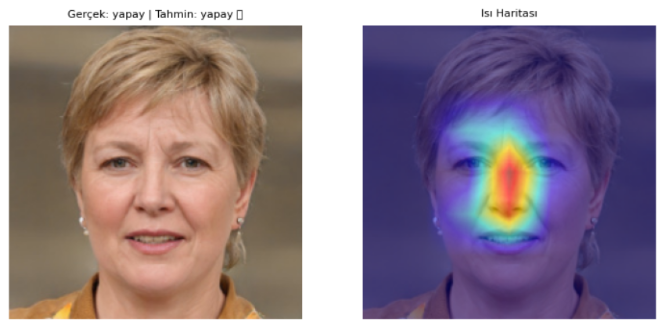
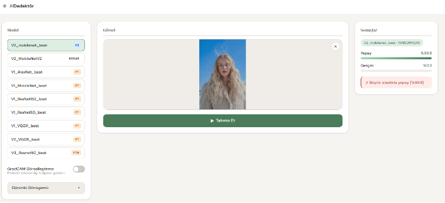
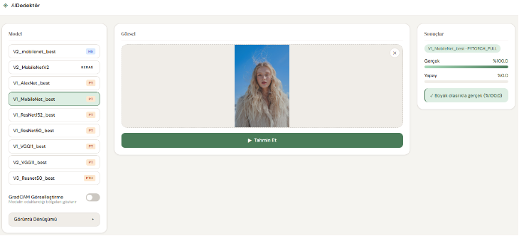

# ◈ AI Dedektör — Yapay Zekâ ile Üretilmiş Yüz Görsellerinin Tespiti

Bir yüz fotoğrafının **gerçek** mi yoksa **yapay zekâ tarafından üretilmiş** mi olduğunu derin öğrenme modelleriyle sınıflandıran ve modelin kararını **Grad-CAM** ısı haritalarıyla açıklayan Flask tabanlı bir web uygulaması.

Proje, Selçuk Üniversitesi Teknoloji Fakültesi Bilgisayar Mühendisliği Bölümü *Mühendislik Tasarımı* dersi kapsamında geliştirilmiştir.

---

## İçindekiler

- [Özellikler](#özellikler)
- [Kullanılan Teknolojiler](#kullanılan-teknolojiler)
- [Veri Seti](#veri-seti)
- [Derin Öğrenme Yöntemleri](#derin-öğrenme-yöntemleri)
- [Deneysel Sonuçlar](#deneysel-sonuçlar)
- [Açıklanabilirlik: Grad-CAM](#açıklanabilirlik-grad-cam)
- [Web Arayüzü](#web-arayüzü)
- [Kurulum ve Kullanım](#kurulum-ve-kullanım)
- [Proje Yapısı](#proje-yapısı)
- [API](#api)

---

## Özellikler

- **9 eğitilmiş model** arasından seçim (ResNet50, ResNet152, VGG11, AlexNet, MobileNet, MobileNetV2)
- **Çoklu framework desteği:** PyTorch (`.pt`, `.pth`) ve TensorFlow/Keras (`.h5`, `.keras`) modelleri aynı arayüzden çalışır; `models/` klasörüne bırakılan modeller otomatik algılanır
- **Grad-CAM görselleştirme:** Modelin karar verirken görselin hangi bölgesine odaklandığını ısı haritası olarak gösterir
- **Görüntü dönüşümleri (robustness testi):** Tahmin öncesinde gürültü, bulanıklaştırma, parlaklık/kontrast, JPEG sıkıştırma ve geometrik dönüşümler uygulanarak modellerin bozulmalara karşı dayanıklılığı test edilebilir
- **Olasılık çıktısı:** Her iki sınıf (Gerçek / Yapay) için yüzdelik güven skoru

## Kullanılan Teknolojiler

| Alan | Teknoloji |
|---|---|
| Derin öğrenme | PyTorch, Torchvision, TensorFlow / Keras |
| Görüntü işleme | OpenCV, Pillow, NumPy |
| Değerlendirme | scikit-learn |
| Açıklanabilir YZ | Grad-CAM (Gradient-weighted Class Activation Mapping) |
| Backend | Python 3.12, Flask |
| Frontend | HTML, CSS, JavaScript |
| Veri temizleme | MD5 özet (hash) algoritması, dupeGuru |

## Veri Seti

Çalışmada üç farklı veri seti versiyonu oluşturulmuş ve modeller bu versiyonlar üzerinde ayrı ayrı eğitilmiştir.

### Versiyon 1 — Ham Veri

- **Yapay görseller:** Generated Photos
- **Gerçek görseller:** IMC Ajans
- **Toplam:** 49.680 görsel — %70 eğitim / %15 doğrulama / %15 test

| Bölüm | Yapay | Gerçek | Toplam |
|---|---:|---:|---:|
| Eğitim | 14.266 | 20.509 | 34.775 |
| Doğrulama | 3.057 | 4.394 | 7.451 |
| Test | 3.058 | 4.396 | 7.454 |

### Versiyon 2 — Sıkıştırılmış Veri

Versiyon 1'deki tüm görseller **224×224** boyutuna getirilmiş ve **%85 JPEG kalitesi** ile yeniden kaydedilmiştir. Bu sayede modellerin dosya formatı, çözünürlük veya sıkıştırma izleri gibi yüzeysel ipuçları yerine görsel içeriğe odaklanması hedeflenmiştir.

### Versiyon 3 — Dengeli Veri

Akademik **SFHQ (Synthetic Faces High Quality) — Text-to-Image** veri seti entegre edilerek dengeli bir set oluşturulmuştur.

- **Toplam:** 11.768 görsel — %80 eğitim (9.413) / %10 doğrulama (1.176) / %10 test (1.179)

### Veri Sızıntısının Önlenmesi

Aynı veya neredeyse aynı görselin hem eğitim hem test kümesinde bulunması, modelin başarısını yapay olarak yüksek gösterir. Bunu engellemek için:

1. **MD5 hash kontrolü:** Her görselin MD5 özeti hesaplanarak birebir aynı dosyalar tespit edilip ayıklanmıştır.
2. **dupeGuru:** Piksel düzeyinde birebir aynı olmayan ancak görsel olarak çok benzer (yeniden boyutlandırılmış, farklı sıkıştırılmış vb.) kopyalar dupeGuru programı ile bulunarak kümeler arası tekrarlar temizlenmiştir.

## Derin Öğrenme Yöntemleri

Problem, **ikili görüntü sınıflandırma** (Gerçek / Yapay) olarak ele alınmış ve farklı derinlik ve karmaşıklıktaki evrişimli sinir ağı (CNN) mimarileri karşılaştırılmıştır:

| Mimari | Framework | Öne çıkan özellik |
|---|---|---|
| **AlexNet** | PyTorch | Modern CNN'lerin öncüsü; referans (baseline) model |
| **VGG11** | PyTorch | 3×3 evrişimlerden oluşan sade ve derin yapı |
| **ResNet50 / ResNet152** | PyTorch | Artık (residual) bağlantılar sayesinde çok derin ağların eğitilebilmesi |
| **MobileNet / MobileNetV2** | PyTorch, Keras | Derinlemesine ayrılabilir evrişimler (depthwise separable conv.) ile hafif ve hızlı yapı |

MobileNetV2 için ek olarak **ince ayar (fine-tuning)** uygulanmış bir model de eğitilmiştir. Tüm modeller 224×224 RGB girdi alır ve piksel değerleri [0, 1] aralığına ölçeklenir.

Model dosyaları, hangi veri seti versiyonuyla eğitildiklerini belirten bir önek taşır:

| Dosya | Mimari | Veri seti |
|---|---|---|
| `V1_AlexNet_best.pt` | AlexNet | Versiyon 1 |
| `V1_MobileNet_best.pt` | MobileNet | Versiyon 1 |
| `V1_ResNet50_best.pt` | ResNet50 | Versiyon 1 |
| `V1_ResNet152_best.pt` | ResNet152 | Versiyon 1 |
| `V1_VGG11_best.pt` | VGG11 | Versiyon 1 |
| `V2_VGG11_best.pt` | VGG11 | Versiyon 2 |
| `V2_mobilenetv2.h5` | MobileNetV2 | Versiyon 2 |
| `V2_MobileNetV2_fine.keras` | MobileNetV2 (ince ayarlı) | Versiyon 2 |
| `V3_Resnet50_best.pth` | ResNet50 | Versiyon 3 |

## Deneysel Sonuçlar

Test kümesi üzerinde elde edilen sonuçlar:

| Model Mimarisi | Veri Seti | Doğruluk | Kesinlik | Duyarlılık | F1-Skoru |
|---|:---:|:---:|:---:|:---:|:---:|
| ResNet50 | Versiyon 1 | %99,97 | %99,97 | %99,97 | %99,97 |
| MobileNet | Versiyon 1 | %99,93 | %99,93 | %99,93 | %99,93 |
| VGG11 | Versiyon 1 | **%99,99** | **%99,99** | **%99,99** | **%99,99** |
| AlexNet | Versiyon 1 | %58,98 | %34,78 | %58,98 | %43,76 |
| ResNet152 | Versiyon 1 | %99,89 | %99,90 | %99,84 | %99,87 |
| VGG11 | Versiyon 2 | **%99,99** | **%99,99** | **%99,99** | **%99,99** |
| MobileNetV2 | Versiyon 2 | %99,89 | %99,84 | %99,90 | %99,87 |
| MobileNetV2 (İnce Ayarlı) | Versiyon 2 | %99,89 | %99,84 | %99,84 | %99,87 |
| ResNet50 | Versiyon 3 | %99,83 | %99,83 | %99,83 | %99,83 |

**Değerlendirme:**

- VGG11, hem ham (V1) hem sıkıştırılmış (V2) veride en yüksek başarıyı göstermiştir.
- AlexNet'in %58,98 doğruluğu, test kümesindeki gerçek görsel oranına (4.396 / 7.454 ≈ %58,98) birebir eşittir. Bu, modelin öğrenemeyip tüm görselleri tek sınıfa (Gerçek) atadığını gösterir; düşük kesinlik değeri de bunu doğrular.
- Sıkıştırılmış veri (V2) ile eğitilen modeller, yüksek başarılarını korumuştur; bu da modellerin yalnızca sıkıştırma/format izlerine dayanmadığına işaret eder.
- Farklı kaynaktan gelen dengeli SFHQ verisi (V3) üzerinde de ResNet50 %99,83 başarıya ulaşmıştır.

## Açıklanabilirlik: Grad-CAM

Yüksek doğruluk değerleri tek başına modelin *doğru nedenlerle* karar verdiğini kanıtlamaz. Bu nedenle modellerin eğitim ve test sürecinde görselin hangi bölgelerine odaklandığını incelemek için **Grad-CAM** yöntemi kullanılmıştır.

Grad-CAM, tahmin edilen sınıfın skorunun son evrişim katmanının aktivasyonlarına göre gradyanını hesaplar; bu gradyanların ortalamasıyla aktivasyon haritalarını ağırlıklandırarak bir ısı haritası üretir. Kırmızı bölgeler modelin kararına en çok etki eden alanları gösterir.

<p align="center">
  
</p>
<p align="center"><em>Yapay zekâ tarafından üretilmiş bir yüz görselinde Grad-CAM çıktısı. Model görseli doğru şekilde "yapay" olarak sınıflandırmış ve kararında yüzün merkez bölgesine (burun, gözler arası) odaklanmıştır.</em></p>

Grad-CAM, uygulamadaki web arayüzünden de tek tıkla açılabilir (bkz. *GradCAM Görselleştirme* anahtarı).

## Web Arayüzü

Arayüz üç panelden oluşur: solda model seçimi, Grad-CAM anahtarı ve görüntü dönüşümleri; ortada görsel yükleme alanı; sağda tahmin sonuçları.

Aşağıdaki iki ekran görüntüsünde kullanılan görsel **yapay zekâ tarafından üretilmiştir**. Aynı görselin farklı modeller tarafından nasıl sınıflandırıldığı gösterilmektedir:

<p align="center">
  
</p>
<p align="center"><em><b>V2 MobileNetV2 (Keras):</b> Görseli %99,8 olasılıkla doğru şekilde <b>yapay</b> olarak sınıflandırıyor.</em></p>

<p align="center">
  
</p>
<p align="center"><em><b>V1 MobileNet (PyTorch):</b> Aynı görseli %100 olasılıkla yanlış şekilde <b>gerçek</b> olarak sınıflandırıyor.</em></p>

Bu karşılaştırma, test kümesinde benzer başarı oranlarına sahip modellerin eğitim verisinin dışından gelen görsellerde farklı davranabildiğini göstermektedir. Sıkıştırılmış veri (V2) ile eğitilen model, gerçek dünyadan gelen bu görselde daha iyi genelleme yapmıştır.

## Kurulum ve Kullanım

### Gereksinimler

- Python 3.10+ (proje Python 3.12 ile geliştirilmiştir)
- Git

### 1. Depoyu klonlayın

```bash
git clone https://github.com/Guzide23/AI_Detector.git
cd AI_Detector
```

### 2. Sanal ortam oluşturun ve bağımlılıkları yükleyin

```bash
python -m venv venv

# Windows
venv\Scripts\activate
# macOS / Linux
source venv/bin/activate

pip install -r requirements.txt
```

> GPU'nuz yoksa PyTorch'un daha küçük olan CPU sürümünü kurabilirsiniz:
> `pip install torch torchvision --index-url https://download.pytorch.org/whl/cpu`

### 3. Modelleri `models/` klasörüne ekleyin

> ⚠️ Eğitilmiş model dosyaları boyutları nedeniyle (toplam ~1,6 GB) bu depoda paylaşılmamaktadır. Uygulamayı çalıştırmak için kendi eğittiğiniz modelleri kullanabilirsiniz.

Uygulama `models/` klasöründeki `.pt`, `.pth`, `.h5`, `.keras`, `.pkl` ve `.joblib` dosyalarını otomatik olarak algılar ve arayüzde listeler. Modeller 224×224 RGB girdi almalı ve 2 sınıflı (Gerçek / Yapay) çıktı vermelidir. PyTorch `state_dict` dosyalarında mimarinin tanınabilmesi için dosya adında mimari adı geçmelidir (örn. `resnet50`, `vgg11`, `mobilenet`).

### 4. Uygulamayı başlatın

```bash
python app.py
```

Tarayıcıdan **http://localhost:5000** adresine gidin.

### 5. Kullanım

1. Sol panelden bir model seçin.
2. Bir yüz görselini sürükleyip bırakın veya seçin (PNG, JPG, JPEG, WEBP, BMP — en fazla 16 MB).
3. İsterseniz **GradCAM Görselleştirme** anahtarını açın ve/veya **Görüntü Dönüşümü** menüsünden bir bozulma seçin.
4. **Tahmin Et** butonuna tıklayın; sonuç sağ panelde gösterilir.

## Proje Yapısı

```
AI_Detector/
├── app.py                  # Flask uygulaması ve API uç noktaları
├── generate_metrics.py     # Eğitim sonrası metrik (JSON) üretme betiği
├── requirements.txt
├── models/                 # Eğitilmiş model dosyaları (depoda paylaşılmaz)
├── utils/
│   ├── model_loader.py     # PyTorch / Keras / sklearn modellerini dinamik yükleme ve tahmin
│   ├── gradcam.py          # PyTorch ve TensorFlow için Grad-CAM
│   └── augmentation.py     # Gürültü, bulanıklık, JPEG vb. görüntü dönüşümleri
├── templates/
│   └── index.html          # Arayüz şablonu
├── static/
│   ├── css/style.css
│   ├── js/main.js
│   └── uploads/            # Yüklenen görseller ve Grad-CAM çıktıları (git'e eklenmez)
└── docs/images/            # README görselleri
```

## API

| Uç nokta | Metot | Açıklama |
|---|---|---|
| `/` | GET | Web arayüzü |
| `/api/models` | GET | `models/` klasöründeki kullanılabilir modellerin listesi |
| `/api/predict` | POST | Tahmin. Form alanları: `image` (dosya), `model_id`, `gradcam` (`true`/`false`), `aug_id` (opsiyonel) |
| `/api/augment` | POST | Seçilen dönüşümün önizlemesi. Form alanları: `image`, `aug_id` |

Örnek istek:

```bash
curl -X POST http://localhost:5000/api/predict \
  -F "image=@ornek.jpg" \
  -F "model_id=V2_mobilenetv2" \
  -F "gradcam=true"
```

---

**Geliştirici:** Güzide Kaya — Selçuk Üniversitesi, Bilgisayar Mühendisliği
